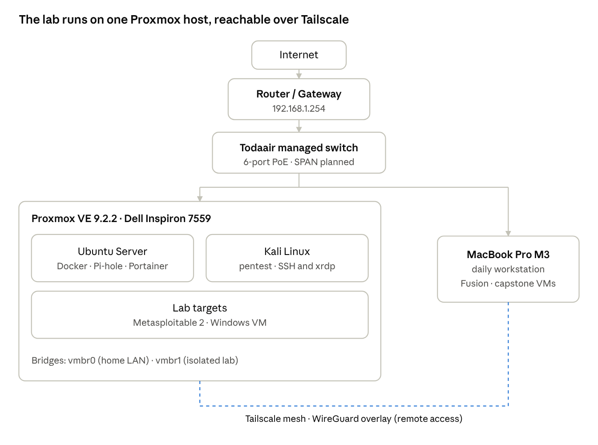

# Homelab: Proxmox Virtualization & Security Lab

Jai Barber · November 2026

## Overview

I run this home lab to get hands-on with the things my cybersecurity degree mostly covers in theory. The core is a single Proxmox server hosting isolated virtual machines, sitting on a flat home network I can packet-capture and pick apart, with Tailscale giving me secure access to all of it from anywhere.

It's where I practice the actual day-to-day of IT and security work: standing up and isolating VMs, running traffic analysis, poking at an IDS, and building the DDoS detection system behind my capstone. Everything runs on hardware I own and configure myself, so when something breaks, I'm the one who fixes it.

## Architecture at a glance

Everything hangs off one managed switch, the Proxmox host does the heavy lifting, and Tailscale makes any node reachable from off-site.

## Hardware

The lab is built from gear I already had plus a couple of targeted additions.

| Device | Role in the lab | Notes |
| --- | --- | --- |
| Dell Inspiron 7559 | Virtualization host | Intel Core i7, 16 GB RAM (maxed), 128 GB M.2 SSD + 1 TB HDD; runs Proxmox VE 9.2.2 |
| MacBook Pro M3 | Daily driver and client | 36 GB RAM, 512 GB storage; my Wireshark, SSH and remote desktop workstation |
| Todaair 6-port managed switch | LAN backbone | Gigabit web-smart PoE switch with VLAN support; will host the SPAN (mirror) port |
| AOC 27-inch + Alienware | Displays | Dual-monitor desk setup |

## Virtualization

Proxmox VE 9.2.2 is the hypervisor, with two Linux bridges: `vmbr0` puts VMs on the home LAN, and `vmbr1` is an isolated lab network with no DHCP and no route out, where the vulnerable targets live.

| VM | Purpose |
| --- | --- |
| Ubuntu Server (`ubuntu01`) | Always-on services in Docker, managed through Portainer: Pi-hole for network-wide DNS filtering, a Homepage dashboard, and Tailscale as a subnet router |
| Kali Linux | Pentesting and traffic analysis (Nmap, Wireshark, Metasploit); reached from my Mac over SSH and xrdp |
| Metasploitable 2 | Intentionally vulnerable target on the isolated `vmbr1` network |
| Windows VM | Isolated lab target for safe testing; not used as a daily OS |

My capstone ran on a second virtualization stack: three Ubuntu VMs on VMware Fusion on the MacBook, on a host-only network with no route out.

The point of running these as VMs is isolation: I can snapshot, break, and rebuild a machine without touching the rest of the network, and keep a target box walled off from everything else.

## Networking

The lab sits on a flat `192.168.1.0/24` home network with the router and gateway at `192.168.1.254`.

- **Managed switch:** a Todaair 6-port web-smart switch is the backbone, and the key to full visibility. My plan is to configure a SPAN (port mirror) so one port receives a copy of all traffic, which lets me capture device-to-device flows a normal switch would never send me. Until that's set up, I capture on the Proxmox `vmbr0` bridge, which sees VM traffic plus the broadcast and multicast chatter that floods every port.
- **Pi-hole:** runs in Docker on `ubuntu01` and handles DNS for the network, blocking ad and tracker domains and giving me a log of what every device is looking up.
- **Tailscale:** a WireGuard-based mesh overlay. `ubuntu01` acts as a subnet router, so I can reach the whole home network securely from off-site. In a recent capture I could see two of my nodes doing NAT traversal and talking directly over the LAN on UDP 41641.
- **Isolated lab network:** `vmbr1` keeps attack traffic and vulnerable machines walled off from the home LAN.
- **Remote access to Kali:** SSH for headless work and xrdp when I need the desktop, both driven from my Mac.

## Security work and projects

This is what I actually do in the lab, not just what's installed.

- **DDoS detection capstone (CMPS 451B, Fall 2026):** my completed senior capstone, "Automated DDoS Detection and Mitigation in Resource-Constrained Environments: A Virtual SOC Approach." I built a Python detector, with Scapy for packet capture, that runs on the protected web server, samples traffic in five-second windows, and flags floods by packet rate and source-address entropy. It then blocks offending sources automatically through iptables and an ipset blocklist, with a live Plotly Dash dashboard for the operator. On an isolated three-VM network, with hping3 as the attacker, it detected and blocked all 12 single-source SYN and UDP floods within one five-second window. Three low-rate floods were caught by entropy alone, and a spoofed-source flood was caught by rate alone, which showed the two metrics cover each other's blind spots. The spoofed flood was deliberately not blocked, because no forged source could be tied to a meaningful share of the traffic.
- **Exploiting Metasploitable 2 (isolated lab):** scanned the target with Nmap from Kali and rooted it through the vsftpd 2.3.4 backdoor, first manually and then with Metasploit, all inside the isolated network. [Writeup on GitHub](https://github.com/blkmonday/metasploitable-2-writeup).
- **Packet capture and analysis (Wireshark, tcpdump):** I capture live traffic and pick it apart. In one session I isolated a FaceTime call and traced its media stream to an Apple relay server, showing the call fell back to relay rather than a direct peer-to-peer path. The same capture revealed a Tailscale mesh doing NAT traversal across dozens of relay servers. I work the data with Statistics > Conversations and display filters to isolate device-to-device flows from the broadcast and multicast noise.
- **Self-hosted services (Docker, Portainer, Pi-hole):** I run and maintain my own container stack, including the DNS the whole house depends on, so uptime and recovery are real concerns and not just lab exercises.
- **Security Onion IDS lab (AWS EC2, Sep 2026):** stood up Security Onion from scratch to practice reviewing IDS alerts and logs, getting reps on the detection side.
- **Password Security Checker:** a portfolio project on my GitHub (`blkmonday`) for evaluating password strength.

Together these cover both sides of the house: offensive tooling and recon, plus defensive detection and traffic analysis.

## Skills and certifications

What the lab backs up with hands-on evidence:

- **Virtualization and Linux:** Proxmox VE, VMware Fusion, Docker and Portainer, Kali and Ubuntu administration, headless management over SSH
- **Network analysis:** Wireshark and tcpdump capture and filtering, reading flows and protocols off the wire
- **Security tooling:** Nmap, Metasploit, hping3, iptables and ipset, Security Onion (IDS and log review)
- **Scripting and dev:** Python (incl. Scapy and Plotly Dash), Java, C++, HTML/CSS/JavaScript
- **Cloud and remote access:** AWS EC2, Tailscale subnet routing (WireGuard overlay), Pi-hole DNS

On the certification track, I'm currently studying for CompTIA Security+, with Network+ next on my list.

## Roadmap

Where the lab is headed next:

- [ ] Reset the managed switch and configure a SPAN/mirror port for full-network capture
- [ ] Add more red-team / blue-team scenarios against the isolated targets
- [ ] Pass CompTIA Security+
- [ ] Dual-boot Asahi Linux on the MacBook Pro for low-level tinkering
